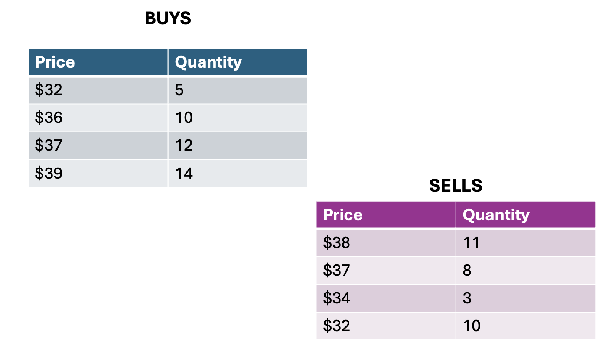

# Parallel Order Book Matching Engine

**Kevin Tang - kktang**, **Spencer Fisher - smfisher**

Project Site: [Parallel-Order-Book](https://github.com/s033Fish/15-418-Parallel-Order-Book)

## Summary:

Our goal is to build a sequential order book matching engine in C++ to increase performance by incorporating parallelism on multicore CPUs. Beyond the obvious split of parallelizing by stock, we will parallelize orders within a specific stock while producing trades identical to a sequential matching engine. We will evaluate the performance of our engine with realistic order submission data from NASDAQ ITCH’s data, which is a live historical data set with real trades from the exchange.

## Background:

An order book is a live list of open buy and sell orders for a specific financial asset. Matching engines use order books as a ledger to pair buyers and sellers whenever there is an overlap in prices. 



In this example, we can see that there is an overlap between the highest buy order and the lowest sell order, which means that the matching engine would need to process these orders.

Exchanges, such as NASDAQ and NYSE, are responsible for hosting and managing the electronic order books where the orders reside. High-Frequency trading (HFT) firms rely on microsecond-level speed to execute various strategies. As such, an exchange is motivated to achieve maximal performance of its order book matching engines to attract more active HFT traders to maximize exchange revenue and market liquidity.

Matching engines use various algorithms to process orders, but the two most common algorithms are pro-rata and price-time. The main difference between the two algorithms is how they fill orders at a certain price level. A pro-rata order book fills proportionally based on size. So each sell order at the same price sells (buy order quantity) * (sell order quantity) / (total sell order quantity at price) units. A price-time order book instead fills by arrival timestamp. This means it will fill sell orders at a certain price that came first before filling any later orders at that price.


## Challenges:

The main challenge with parallelizing an order book is the numerous dependencies in the matching algorithms. Both matching algorithms are inherently sequential, as the outcome of order i depends on the state left by orders 0 through i-1. In addition, to maintain fairness across placed orders, orders need to be processed in the sequence that they are received by the exchange, which again is inherently sequential. For price-time based matching algorithms, the filling process for each price level is conceptually sequential, as the amount of remaining stocks for a sell order depends on how many orders were filled of all of the earlier orders for that price.

Workload imbalance also presents additional challenges, as certain stocks are traded more frequently than others. Most transactions also occur at the top of the order book, which gives rise to difficulty in parallelization across prices. This also creates memory access issues, as these price levels will be accessed frequently, leading to heavy cache contention.

The main constraint is that the performance of the parallel algorithm must operate in the exact same manner as the sequential order, so there can be no reordering of transactions.

## Resources:

We’ll conduct our testing on both GHC and PSC machines. We would like to use the PSC machines since stock exchanges typically process massive loads of incoming transactions, which we believe would be better simulated on PSC’s 128-core nodes, where we can stress-test scalability under heavy load beyond what GHC’s 8 cores allow.

## Goals and Deliverables:

Plan to Achieve:
- Implement a correct sequential matching engine as well as an automated correctness checker to compare output between versions
- A per-stock parallelized baseline that splits matching based on specific stocks
- Compare data structure locking implementations (fine-grained, coarse-grained, lock-free)
- Implement a within-stock parallelized matching engine that speeds up pro-rata and price-time algorithms

Hope to Achieve:
- Be able to support buy stop and sell stop orders with our matching engine
- Experiment with a fairness-relaxing and batch auction matching engine to compare how performance changes when we allow for higher parallelism but weaker fairness

## Platform:

Order books are traditionally implemented with C++ since matching speed comes down to memory layout, cache behavior, and synchronization cost, and C++ lets you control all three directly.

## Schedule:

Week 1: Sequential implementation, testing different data structures to identify benchmarks. Create a correctness and performance testing platform based on NASDAQ ITCH’s data.

Week 2: Complete across-stock parallel implementation and compare various workload-assigning types (dynamic vs. static vs. semi-static)

Week 3: Complete initial within-stock parallel implementation

Week 4: Optimize within-stock parallel implementation for memory layout, contention, etc. to achieve maximum performance

Week 5: Gather performance comparison data on GHC and PSC and complete the final project report

## Build and Test

```
cmake -S . -B build && cmake --build build -j
./build/test_itch_parser
./build/test_engine
```

## Downloading, Parsing, and Matching ITCH Data

```
# Download:
mkdir -p /tmp/$USER && chmod 700 /tmp/$USER
cd /tmp/$USER
wget "https://emi.nasdaq.com/ITCH/Nasdaq%20ITCH/01302019.NASDAQ_ITCH50.gz"


# Parse:
# For a few stocks:
./build/itch_parse /tmp/$USER/01302019.NASDAQ_ITCH50.gz /tmp/$USER/small.bin AAPL MSFT AMD

# For every stock:
./build/itch_parse /tmp/$USER/01302019.NASDAQ_ITCH50.gz /tmp/$USER/full.bin

# Run the Engine:
./build/run_engine /tmp/$USER/small.bin pro-rata trades_pr.bin
./build/run_engine /tmp/$USER/small.bin price-time trades_pt.bin
```

## Correctness & Benchmarking (Parallel vs. Sequential)

`tests/checker/` holds the harness that checks every engine against the sequential reference and benchmarks it.

| File | Purpose |
|---|---|
| `engine_api.hpp` | `MatchingEngine` interface every engine variant is wrapped in |
| `engines.hpp` | Adapters + registry (`seq` today; add parallel engines here) |
| `compare.hpp` | Per-stock, field-by-field trade comparison and final-book comparison |
| `bench.hpp` | Timing harness (warmup, reps, min/median/mean/stddev) |
| `event_gen.hpp` | Seeded random event streams (Zipf-skewed stocks, hot top-of-book) |
| `check_engine.cpp` | CLI: correctness checks + benchmark table / CSV |
| `test_checker.cpp` | Self-test proving the checker catches corrupted output |

**Correctness rule:** trades of different stocks may come out in any order, but each stock's trades must match the sequential engine exactly, in order, and every stock's final book must match.

```
# All tests (unit tests, checker self-test, random-stream smoke check)
cd build && ctest --output-on-failure

# Random stream: check + benchmark all engines over thread counts
./build/check_engine --random 2000000 --stocks 100 --rule both --threads 1,2,4,8 --reps 5

# Real ITCH data, results to CSV for plots
./build/check_engine --events /tmp/$USER/small.bin --rule both --csv results.csv

# Hunt for races: correctness only, many repetitions
./build/check_engine --random 500000 --stocks 3 --check-reps 50 --no-bench
```

Options: `--engines a,b` (default: all registered), `--threads` (default: 1,2,4,... up to hardware threads), `--warmup`, `--reps`, `--check-reps`, `--seed`, `--no-bench`. Only `run()` is timed, on a fresh engine each repetition; speedup = sequential median / candidate median, efficiency = speedup / threads.

**Adding a parallel engine:** implement it in its own header, write an adapter subclass of `ob::check::MatchingEngine` in `tests/checker/engines.hpp` (see `SequentialAdapter`), and add one line to `registry()`.


## Across-Stock Parallel Engine (Week 2)

`parallel/across-stock-engine.hpp` replays each stock's events on exactly one thread. Books of different stocks share no state, so no locks are needed and each stock's trades come out in the same order as the sequential engine. Each `run()`:
1. partitions the events by stock (sequential counting sort, keeps arrival order),
2. assigns stocks to threads by the chosen `Schedule`,
3. matches in parallel into per-thread trade vectors,
4. concatenates the vectors (sequential merge).

| Schedule | Checker name | Assignment |
|---|---|---|
| `STATIC` | `stock-static` | k-th active stock → thread k % T, ignoring load |
| `DYNAMIC` | `stock-dynamic` | threads take the next stock from a shared atomic counter |
| `SEMI_STATIC` | `stock-semi` | stream cut into epochs (2^18 events); each epoch, heaviest stock first onto the least-loaded thread, using the previous epoch's event counts as the cost estimate |

```
./build/check_engine --random 4000000 --stocks 100 --rule both --threads 1,2,4,8 --csv week2.csv
./build/check_engine --events /tmp/$USER/full.bin --engines stock-static,stock-dynamic,stock-semi --rule both
```

Known simplifications in this first iteration (room for improvement):
- Partition and merge are sequential.
- Threads are spawned per run, and per epoch for semi-static (no thread pool).
- `OrderBook`s sit next to each other in one vector (possible false sharing).
- Dynamic hands out one stock at a time in id order (no heaviest-first ordering).
- Event count is a crude cost estimate (pro-rata cost depends on level depth).
- The busiest stock caps speedup at about 1 / (its share of events).
